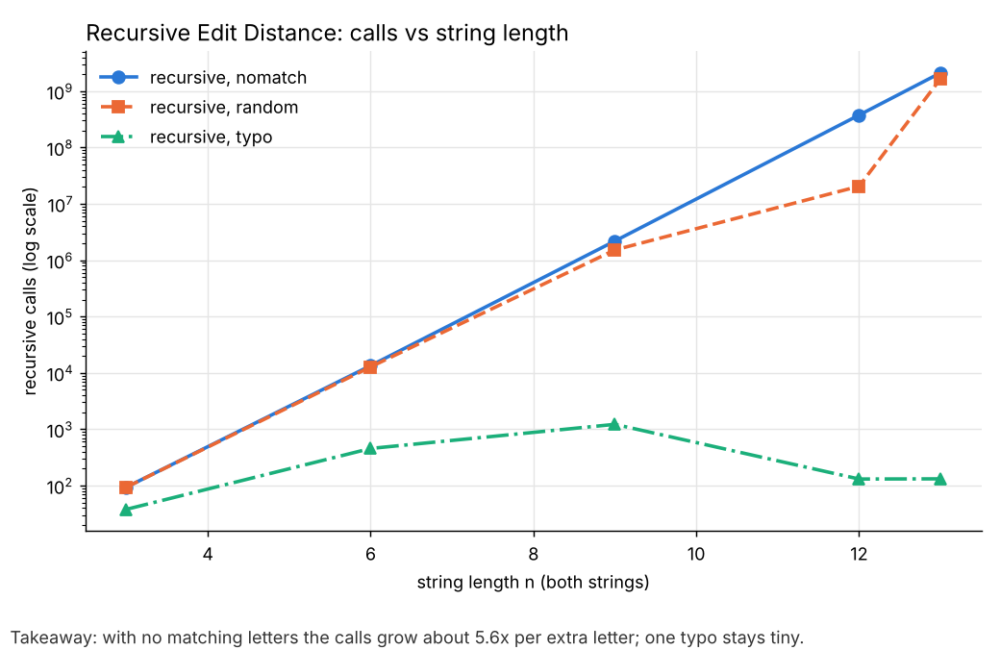
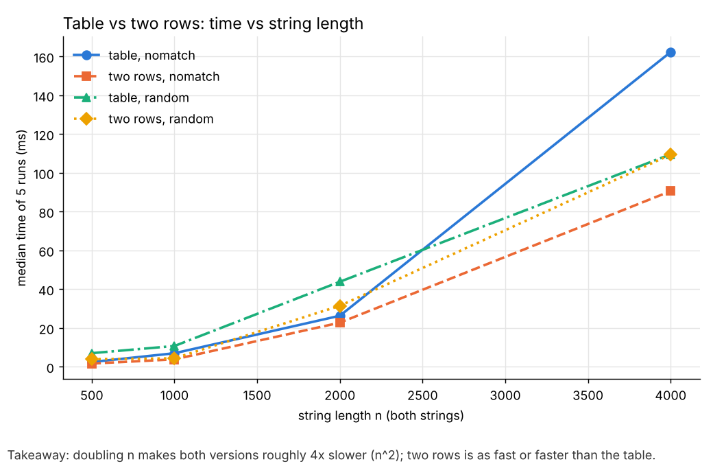
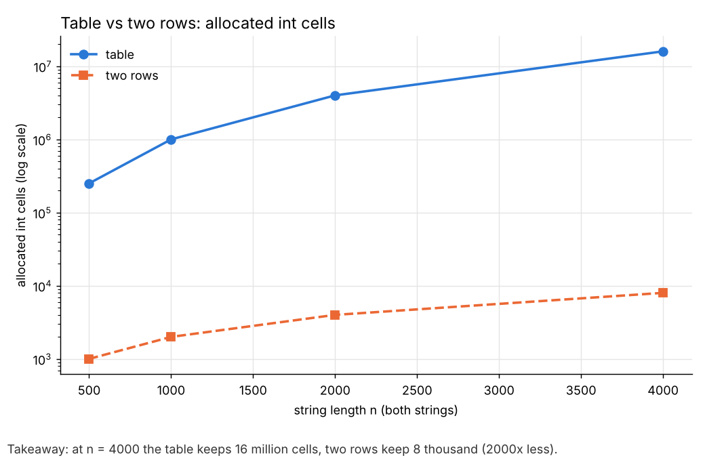
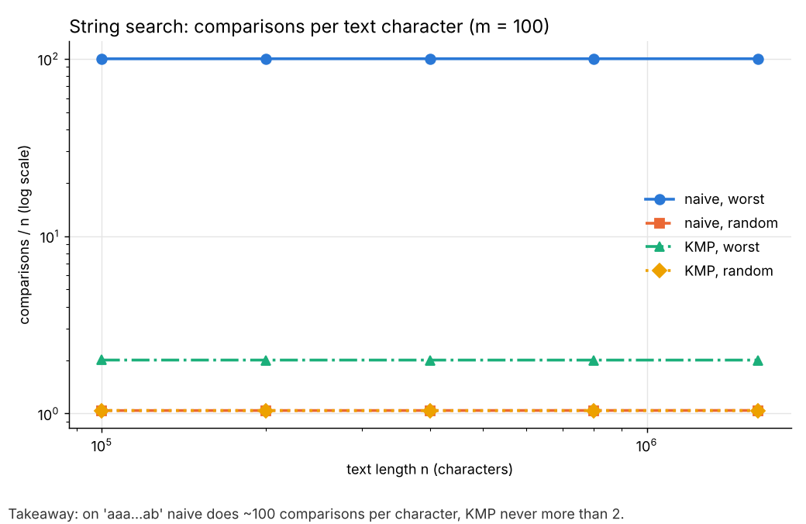
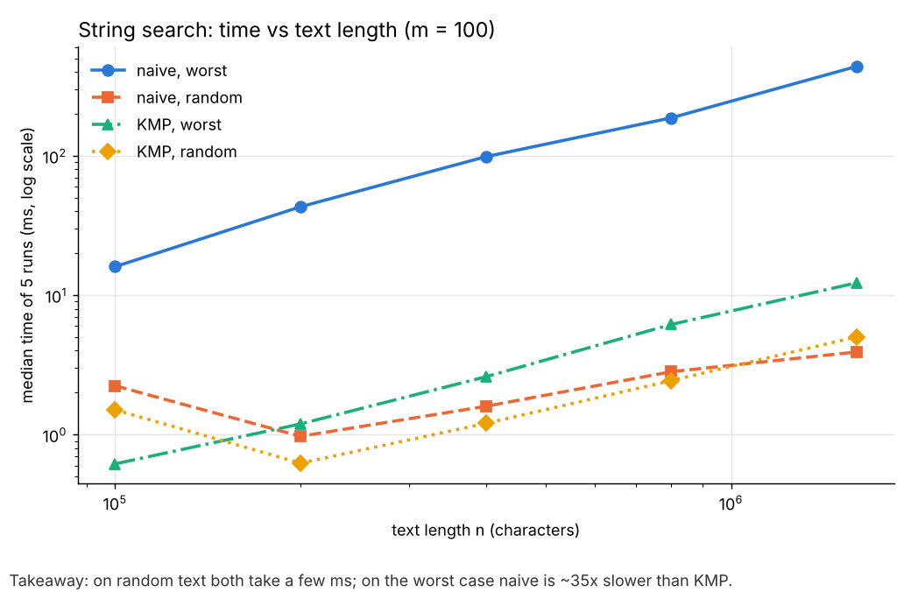

# Assignment 4 Report: Dynamic Programming and String Algorithms

Design and Analysis of Algorithms. Yussupov Nurlan, group SE-2526. Instructor: Taubakabyl Nurlybek. November 2026.

## 1. Experiment Design Card

Written before the first run. One change was made after the first run (see the end of this section).

| Field | Edit Distance | String Search |
|---|---|---|
| **Question** | Does the recursive version really grow exponentially, and do the table and two-row versions grow as n·m with the same work but different memory? | Does Naive really do about n·m comparisons on a bad input while KMP stays linear (at most 2n)? |
| **Sizes (n)** | Recursive: 3, 6, 9, 12 (small, because the cost explodes). Table and two rows: 500, 1000, 2000, 4000 (each step doubles n, so n² should grow 4x). Both strings have length n. | Text length: 100 000, 200 000, 400 000, 800 000, 1 600 000 (16x range). Pattern length m = 100 for all runs, so only n changes. |
| **Inputs** | `random`: two random strings over a–z, the average case. `nomatch`: "aaa…a" vs "bbb…b", no letter ever matches, so the recursion always splits into 3 calls (worst case for recursion). `typo`: a random string and the same string with one letter changed, like "Abylai Han" vs "Abylai Khan" (best case for recursion, realistic for the city platform). | `random`: random text and random pattern over a–z, almost every first comparison fails (the usual case). `worst`: text "aaa…a" and pattern "aa…ab" (99 a's and one b): Naive matches 99 letters at every position before it fails (worst case for Naive). |
| **Metrics** | `steps`: recursive calls (recursive) or filled cells (table, two rows), counted inside the code; this is the unit of work in the DP. `memory_cells`: int cells allocated by the version, counted when the arrays are created. `time_ms`: median of 5 runs after 1 warm-up run. | `comparisons`: every character comparison, in the search and in the LPS build, counted inside the code. `time_ms`: median of 5 runs after 1 warm-up run. |
| **Prediction** | Recursive on `nomatch`: about ×5–6 calls per extra letter (straight line on a log axis); `typo` stays small because matching letters go straight down the diagonal. Table and two rows: steps = n² exactly for every input, time ×4 when n doubles. Two rows uses about n/2 times less memory. | Naive `random`: ≈ n comparisons. Naive `worst`: ≈ n·m = 100n. KMP: between n and 2n for both inputs. On the worst input Naive should be many times slower in time too. |
| **Plots** | (1) Recursive calls vs n, log y axis: is the growth exponential? (2) Time vs n for table and two rows: is it n² and which is faster? (3) Allocated cells vs n, log y: how much memory do two rows save? | (4) Comparisons / n vs n (a ratio, log axes): does each algorithm do a constant amount of work per character, and how big is that constant? (5) Time vs n, log axes: does the clock agree with the counters? |

**Change after the first run:** the recursive sizes 3, 6, 9, 12 finished quickly (12 took about 1 s), so I added **n = 13** to see where the recursion stops being practical. Everything else stayed the same.

Reproducibility: `InputGenerator` uses `java.util.Random` with seed `42 + n`, so the same command gives the same strings and the same counters. Only the times change a little between runs.

## 2. Plots and Results

All numbers are from `results/results.csv` (5 runs per point; the plots use the median time).

With no matching letters the calls grow about 5.6x per extra letter; one typo stays tiny.

Doubling n makes both versions roughly 4x slower (n²); two rows is as fast or faster than the table.

At n = 4000 the table keeps 16 million cells, two rows keep 8 thousand (2000x less).

On "aaa…ab" Naive does about 100 comparisons per character, KMP never more than 2.

On random text both take a few ms; on the worst case Naive is about 35x slower than KMP.

Key numbers:

| Algorithm | Input | n | steps / comparisons | median time |
|---|---|---|---|---|
| recursive | nomatch | 12 | 377 393 953 calls | 956 ms |
| recursive | nomatch | 13 | 2 114 900 428 calls | 6 457 ms |
| recursive | typo | 13 | 132 calls | 0.001 ms |
| table | nomatch | 4000 | 16 000 000 cells | 162 ms |
| two rows | nomatch | 4000 | 16 000 000 cells | 91 ms |
| naive | worst | 1 600 000 | 159 990 100 comparisons | 438 ms |
| KMP | worst | 1 600 000 | 3 200 098 comparisons | 12 ms |
| naive | random | 1 600 000 | 1 664 236 comparisons | 3.9 ms |
| KMP | random | 1 600 000 | 1 661 964 comparisons | 5.0 ms |

## 3. Prediction vs Result

**Edit Distance.** Expected: exponential recursion on `nomatch`, n² for the other two, same steps but less memory for two rows. Seen: on `nomatch` the calls go 94 → 13 483 → 2.19 M → 377 M → 2.11 B, and from n = 12 to 13 the factor is 5.6, which is inside the predicted 5–6 (the exact number of calls is a Delannoy-type number that grows about 5.83x per letter). `typo` stayed at a few hundred calls, as predicted. One surprise: `random` at n = 12 needed only 20 M calls, much fewer than `nomatch`, but at n = 13 it needed 1.67 B. The reason is that with random letters a few letters happen to match, and every match near the end of the strings removes two of the three branches. So random input sometimes hides the worst case, which is why the `nomatch` input was needed. Table and two rows did exactly n² steps for every input (250 000, 1 M, 4 M, 16 M), as predicted, and the time grew about 2–6x per doubling, around 4x on average (small sizes are noisy, see section 5). Two rows was a bit faster than the table at large n (91 ms vs 162 ms on `nomatch`, n = 4000). I predicted only a memory difference; the time difference comes from memory traffic: the 64 MB table does not fit in the CPU cache, the two 16 KB rows do.

**String Search.** Expected: Naive ≈ 100n on the worst input, KMP ≤ 2n, both ≈ n on random text. Seen: Naive did exactly (n − m + 1)·m comparisons on the worst input (9 990 100 for n = 100 000), KMP did 2n + 98 (the 98 comes from building the LPS array), and on random text both did about 1.04n. The ratio plot is flat, so both algorithms are linear in n for a fixed m, with very different constants. The clock agreed: on the worst input Naive was 26–38x slower. On random text KMP was not faster (5.0 ms vs 3.9 ms at n = 1.6 M) because both do the same number of comparisons and KMP has a little more logic per step. This matches the counters, but I did not predict it.

## 4. Short Answers

**Which input made your string search slowest, and why?** The slowest run was Naive on the `worst` input: text "aaa…a" and pattern "aa…ab". At every start position Naive matches 99 letters and fails only on the last one, then it moves one position to the right and starts again from the first letter of the pattern. This gives (n − m + 1)·m ≈ 100n comparisons, 160 million for n = 1.6 M. KMP on the same input does only 2n comparisons because, after a mismatch, the LPS array tells it how much of the pattern is already matched, so it never reads a text character again from the start.

**How large an n could the recursive Edit Distance handle, and what stopped it?** On the hard input (`nomatch`) it handled n = 13 in about 6.5 s with 2.1 billion calls. Each extra letter multiplies the calls by about 5.6, so n = 14 would take about 36 s, n = 15 about 3.5 minutes and n = 20 about two weeks. The limit is time, not memory: the recursion depth is only n + m, but the same subproblems are solved again and again because there is no table to remember them. On the easy input (`typo`) the same code finishes n = 13 in 132 calls, so the limit depends a lot on the input.

**What do you gain and what do you lose with two rows instead of the full table?** I gain memory: 2(m + 1) cells instead of (n + 1)(m + 1), at n = 4000 that is 8 002 cells (32 KB) instead of 16 million cells (64 MB). In my runs it was also mostly as fast or faster, because the two small rows stay in the cache. The number of steps is the same, n·m. I lose the full table, so I can only get the number, not the list of edits: to rebuild which letters were inserted, deleted or replaced you need to walk back through the whole table.

**Which string search would you choose for the city platform?** KMP. The operators search very long log files, and logs often contain long repeated parts (the same prefix, "aaaa" lines, long runs of the same symbol), which is close to my worst input. There Naive was 35x slower, while KMP is guaranteed to stay below 2n comparisons for any text. On normal random text KMP is only slightly slower than Naive, so the safe choice costs almost nothing.

## 5. One Paragraph on Time

The measured times were mostly what the counters said, but noisy. Small inputs took less than 1 ms and the first sizes were sometimes slower than bigger ones (for example Naive on random text: 2.2 ms for n = 100 000 but 1.0 ms for n = 200 000) because the Java JIT compiler was still warming up, and garbage collection can add jumps (table, n = 4000). I used one warm-up run and the median of 5 runs to reduce this, but the time still depends on my laptop, other programs and the JVM. The counters do not have these problems: they give the same number every run, they are counted inside the algorithm, and they match the formulas exactly (n² cells, (n − m + 1)·m comparisons, 2n + 98 for KMP). So I use the counters as the main evidence and the time as a check that the counted work is also the real cost.
